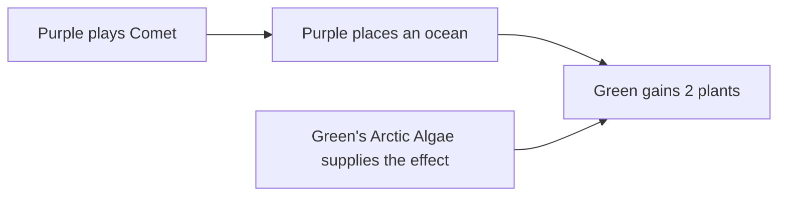

# Attribution, card payoffs, and reinforcement learning

> **Agent information:** Research and design notes maintained by agents.
>
> **Read when:** investigating card payoffs, shared causes, decision-quality explanations,
> discount accounting, or payoff information as reinforcement-learning training data.
>
> **Status:** the purpose and exclusions below are agreed scope. Reporting designs and learning
> experiments are proposals, not implemented features or approved implementation plans.
>
> **Evidence checked:** 2026-11-14 on work5 at `f0f9a76d0`, following the 2026-11-12 investigation.
> The focused replay and its export/reimport check passed again.

## Purpose and agreed scope

The human goal is to help a player understand **how good or bad a decision it was to play a card
at all**. The software can supply evidence without producing a complete judgment. Timing,
uncertainty, other uses of the resources, and the player's plans remain relevant even when they
cannot be assigned reliable numerical values.

The related research question is whether the same payoff information can help an RL player learn
faster or win more often against other AI players. This is plausible, but no competitive improvement from this
attribution approach has been demonstrated in Solarnet.

Preserve these decisions:

- Prioritize understanding the purchase or play decision over finding a uniquely fair division of
  every benefit among its causes.
- **Counterfactual exploration was dropped as too complex.** Do not make alternative-history
  search, removing cards and replaying the future, or an exhaustive evaluator a prerequisite.
  This exclusion applies to the proposed attribution work, not to unrelated existing engine tools.
- Work from actual play and recorded consequences. A player may still judge other uses of their
  money; the software need not simulate those alternatives.
- A benefit can depend jointly on an earlier investment and a later triggering decision.
  Preserve that relationship even when an additive allocation is unavailable or unhelpful.
- Treat reinforcement-learning applications as research proposals. Auxiliary payoff prediction is
  the recommended first experiment from this investigation; it has not been selected for implementation.
- Preserve the distinction between observed payoffs, accounting conventions, estimates, and
  strategic judgments. A large realized payout does not establish a good decision.

This note does not select a new engine API, component, history format, report UI, or learning
architecture. Start with analysis derived from existing records. Missing evidence does not, by
itself, justify adding permanent gameplay machinery.

## The questions hidden inside "credit"

Several questions can concern the same event while requiring different answers.

| Question | Example | What the answer establishes |
| --- | --- | --- |
| What happened? | Media Group paid 3 M€ after an event card was played. | An observed consequence. |
| Which rule supplied it, and what activated the rule? | Media Group supplied the effect; the event-card play activated it. | Joint explanatory attribution. |
| How should a total be divided? | Assign the 3 M€ to Media Group, to the event play, or split it. | An accounting convention. |
| Was the investment productive in this game? | Media Group's payments, costs, and timing across the recorded game. | Evidence relevant to the purchase decision. |
| Was the decision good given what the player knew? | Whether those benefits were foreseeable and worth the expenditure. | A judgment requiring more than the realized ledger. |
| What can an AI learn from this? | Predict future activations and payouts from the position at purchase. | A possible training task, not a direct definition of winning play. |

"Payoff" should name its contents: money received, resources spent, production gained, cards
exchanged, points scored, or a specified valuation. Do not let the word silently stand for a
universal measure of strategic value.

A discounted card can be a sensible purchase because an earlier investment is already in play.
That earlier investment can also deserve recognition for making later purchases productive.
Separate assessments of those decisions need not be additive shares of the game's final result.

## What the current engine records

### Effect context and triggering event

[GameEvent.kt](../../src/common/dev/martianzoo/state/GameEvent.kt) defines
`ChangeEvent.Cause(context, triggerEvent)`:

- `context` identifies the type of the component whose effect supplied the work.
- `triggerEvent` identifies the earlier change that activated that effect.

[PendingTask.fromEffect](../../src/common/dev/martianzoo/engine/PendingTask.kt) records both when
creating effect work. Following trigger events can expose several steps of derivation, such as a
card producing a temperature increase, a track bonus producing an ocean, and Arctic Algae
responding to that ocean.

The cause is an effect-execution record. It is not a complete list of all conditions that made the
result possible. It also does not directly identify the earlier acquisition event of the component
named by the context.

[Effector.kt](../../src/common/dev/martianzoo/engine/Effector.kt) distinguishes immediate effects
from queued effects and routes their consequences through the ordinary engine. Independent
immediate listeners have a stable diagnostic order, with a diagnostic mode that randomizes that
order. That order must not become a theory of strategic contribution.

### Actor, owner, recipient, and submitted choice

These roles can differ:

- the player making a meaningful decision;
- the Actor recorded on an engine change;
- the owner of the effect provider;
- the player receiving the benefit;
- the Actor submitting or automatically completing a particular task.

An opponent can place an ocean and thereby give Arctic Algae's owner plants. A World Government
ocean can be recorded as Admin work even though a player's choice is relevant to the explanation.

[Motivation.kt](../../src/common/dev/martianzoo/state/Motivation.kt) distinguishes client requests,
Admin handling, and Player policy handling. Motivation says why execution happened then; it does
not prove that a human made a strategic choice at that moment. Several transactions or task
submissions may implement a meaningful card play.

Use [IDENTITY.md](IDENTITY.md) and [ENGINE.md](ENGINE.md#transaction-history-and-checkpoints)
for the owning contracts. Admin processing must not be assigned strategic credit merely because
Admin performed bookkeeping.

### Existing summary support

[Summarizer.kt](../../test/common/dev/martianzoo/tfm/tests/replays/Summarizer.kt) can total gains
minus removals for a resource type, filtered by the supplying context. Its `sourceContext`
follows through computed custom-instruction signals to recover the earlier supplying context.
It also counts signal occurrences separately.

This is useful evidence for direct-effect accounting. It is not a general attribution service:
it does not reconstruct all prerequisite dependencies, recover unique origins of pooled resources,
or evaluate whether a card was worth playing.

Contexts can themselves be helper components. For example,
[ResourceValue in payment.pets](../../pets/src/common/dev/martianzoo/tfm/canon/bundles/base/payment.pets)
includes `GrantedResourceValue`, whose `Cardbound` relationship can identify the card granting
a metal-value increase. Reporting that relationship is different from assuming every helper
context is already a card name.

### Limits of execution ancestry

The records do not directly answer every economically useful question:

- **Accumulated production:** `ProductionPhase` activates a production component. That payout's
  cause does not list all earlier cards that added to the production level. See
  [resources.pets](../../pets/src/common/dev/martianzoo/tfm/canon/bundles/base/resources.pets).
- **Pooled money and resources:** resources of the same type are interchangeable. Spending 5 M€
  does not identify which earlier income paid for it. A chosen allocation could be useful, but it
  would be a convention.
- **Prerequisites:** science tags can make Warp Drive playable without becoming its later
  discount events' trigger ancestors.
- **Read dependencies:** an effect can calculate its output from the current state. Its cause
  does not enumerate every earlier event responsible for the quantities read.
- **Scoring:** an end-of-game effect can inspect accumulated animals, tags, or tiles; its immediate
  trigger is the end of the game.
- **Inactive opportunities:** an unused action or a triggered option that was declined is not
  equivalent to an effect that never became available. Task history may provide relevant evidence,
  but resource changes alone cannot establish the distinction.

Following trigger ancestry without a stopping rule eventually reaches turn transitions, earlier
passes, and setup. Assigning all subsequent benefits to those ancestors would obscure the
decisions of interest. A report needs a stated interpretation of meaningful plays and effects;
a raw root event is not automatically the right explanation.

## Verified replay examples

The examples below measure the executable
[CosmicProtonTraceTest](../../test/jvm/dev/martianzoo/tfm/tests/replays/CosmicProtonTraceTest.kt)
under its supplied premise. They are not an independent verification of the original game's
physical or digital rules history. Original evidence is retained under
`_local/replays/CosmicProtonTrace/`, as identified by the replay.

The 2026-11-14 verification command was:

```sh
./gradlew :tfm-tests:replayTest --tests '*CosmicProtonTraceTest' -PreplayExports --console=plain
```

The test passed with zero failures or errors and reported
`Game-file round-trip passed: CosmicProtonTraceTest`. The resulting full recording contained
19,810 events, including 5,462 component-change events. These counts describe that run, not a
contract. Regeneration can change ordinals and task counts.

Exports are generated under the tfm-tests module's isolated build directory,
`generated/replay-event-logs/`; see [TESTING.md](TESTING.md#standard-verification) and
[EXPORT.md](EXPORT.md). Inspect changes, their contexts, and their trigger ancestry. Task events
are not additional resource gains. Match examples by card, player, and change rather than assuming
an old ordinal remains stable.

### Arctic Algae: joint effects, opponents, and a longer chain

Green's Arctic Algae produced 19 plants:

| Observed source of activation | Plants received by Green |
| --- | ---: |
| Arctic Algae's immediate play effect | 1 |
| Purple's Comet ocean | 2 |
| Purple's Convoy From Europa ocean | 2 |
| Green's Giant Ice Asteroid: its two oceans | 4 |
| Additional ocean reached through Giant Ice Asteroid's temperature increase | 2 |
| Yellow's Ice Asteroid: its two oceans | 4 |
| World Government ocean associated with Green | 2 |
| World Government ocean associated with Yellow | 2 |
| **Total** | **19** |

The additional Giant Ice Asteroid ocean was supplied through `ExtendedGlobalParametersRule`
in this Amazonis replay. This is a specific chain in the modeled game, not a claim that every
Giant Ice Asteroid play gives three oceans.

A useful explanation is:

> Arctic Algae produced 19 plants: 1 immediately, 6 following your Giant Ice Asteroid,
> 8 following opponents' card plays, and 4 following World Government oceans.

The explanation credits the investment while exposing how dependent its realized return was on
later events, including other players' decisions. It does not establish how many of those
activations the player could have predicted when buying Arctic Algae.

For a particular Comet payout:



The card that supplied the effect and the play that activated it both belong in the explanation.
The diagram does not imply that the benefit should be divided equally.

### Pets: indirect benefits and scoring thresholds

Yellow's Pets received five animals: its initial animal and four city-triggered gains. The cities
included Green's Underground City, Blue's and Purple's city standard projects, and Yellow's
Lava Tube Settlement. Pets then scored two victory points.

This demonstrates both opponent-supplied activations and the nonlinearity of scoring. At this
endpoint, five animals score the same as four. A report of animals is useful, but a fixed
per-animal strategic value would hide the scoring threshold and timing.

The log associates final scoring with Pets and the end event. Connecting those points back to
particular earlier city plays requires an additional interpretation; the scoring event does not
itself provide that allocation.

### Mars University: net counts can hide the benefit

Yellow used Mars University to discard four cards and draw four cards. Its contribution to net
hand size was zero. The exchange could still improve hand quality. The replay also records its
separate end-of-game victory point.

Retain gross movements as well as net totals. "Four exchanges" is meaningful evidence;
"zero net cards" alone is an inadequate account. Card identities and player judgment may add
context, but an exchange count does not prove that the drawn cards were better.

## Discount accounting and double counting

### The 9-cost card example

Warp Drive's current declaration applies a 4 M€ reduction when paying for a space tag; see
[the Colonies card declarations](../../pets/src/common/dev/martianzoo/tfm/canon/bundles/colonies/cards.json5),
search `WarpDrive`.

For arithmetic only, suppose an eligible 9-cost card receives that discount and eventually returns
12 M€. Ignore timing, card acquisition costs, alternative payments, and Warp Drive's own cost and
other benefits. This is an illustrative payoff, not a claim about a particular Canon card.

The purchase spends 5 M€ and returns 12 M€: a net 7 M€.

| Allocation of this purchase's savings | Net assigned to purchased card | Assigned to Warp Drive | Total |
| --- | ---: | ---: | ---: |
| All savings stay with the purchased card | 12 - 5 = 7 | 0 | 7 |
| All savings go to Warp Drive | 12 - 9 = 3 | 4 | 7 |
| Savings divided equally | 12 - 7 = 5 | 2 | 7 |
| Savings counted in both places | 12 - 5 = 7 | 4 | **11: double counting** |

The allocated cost of 7 in the third row is not the actual payment. The actual payment remains 5.

For understanding the later decision, 5 is the relevant additional expenditure because Warp Drive
is already in play. For understanding the earlier Warp Drive decision, later discounts are useful
evidence of its productivity. These are different assessments and may both discuss the interaction.
They must not be added as independent pieces of a conserved total.

A full investment account must include Warp Drive's own acquisition and play costs and its other
effects, under a stated valuation. Its discount payouts alone are not its ROI.

### Reductions of a bill are not ordinary income

A removed `Owed` component can represent a discount or payment bookkeeping. It is not necessarily
money entering the player's resource pool. Preserve the distinction among:

- the printed/reference price;
- actual resources spent;
- price adjustments;
- the value assigned to resources used for payment;
- an analytical allocation of savings.

Counting actual payment and then subtracting the same discount again understates cost. Counting a
metal payment and its resulting debt reduction as two costs overstates expenditure. Recorded
payment value is also not automatically the strategic value of retaining that metal.

### Capped effects make per-provider totals order-dependent

Consider an illustrative 3 M€ bill with independent discounts of 4 and 2:

| Application order | Recorded reduction by the 4-discount | Recorded reduction by the 2-discount | Total |
| --- | ---: | ---: | ---: |
| Larger first | 3 | 0 | 3 |
| Smaller first | 1 | 2 | 3 |

The final payment is the same, but recorded reductions differ by provider. An effect clipped at
zero debt may leave no record of its full nominal capacity in the component changes.

The existing Advanced Alloys issue is tracked in [TODO.md](../../TODO.md), search
`order-dependent Advanced Alloys discount attribution`. Its historical randomized-order
diagnostic produced different summary totals while preceding game-state checks passed. That
diagnostic was not rerun for this documentation change.

Raw debt reductions can explain what the engine did in a particular execution. They cannot
automatically be treated as execution-order-independent measures of strategic contribution.
Changing listener order to obtain attractive credit totals would not solve the analytical problem.

Nominal reductions and actual capped savings answer different questions. Any future allocation
among overlapping providers must name its convention and reconcile to the applicable total.
The choice of convention and the need for additional evidence remain unresolved.

## Accounting principles for a useful report

These are proposed reporting criteria, not new engine semantics.

### Keep the joint event intact

Represent the Comet example as a joint fact: Green received 2 plants through Green's Arctic Algae,
activated by Purple's Comet ocean. Provide different views of that same fact:

- a card view: what Arctic Algae produced;
- a play view: what followed Purple's Comet;
- a recipient view: what Green received;
- a timing view: when the plants became available.

For a clearly defined set of immediate payouts, a table could put triggering plays in rows and
effect providers in columns. Each cell is counted once. Row totals and column totals describe the
same overall quantity from different directions; adding both sets of totals double counts it.

This is a presentation idea, not a proposed second game-state model. Longer chains must not be
expanded into several indistinguishable copies of the same payoff. Retain event references so a
reader can inspect why a relationship was asserted.

### Retain quantities before valuations

Keep resource types, recipients, gross gains, gross costs, and timing. Do not silently turn plants,
money, production, cards, and victory points into interchangeable units.

Specific pitfalls include:

- Valuing a production increase by all its expected future income, then adding that same realized
  income again.
- Valuing a resource when acquired and counting its later conversion as an unrelated additional
  gain without recognizing consumption.
- Treating a signal's occurrence as a resource balance. Signals may be recorded as transmutations
  with the same gaining and removing type.
- Hiding card exchanges behind zero net hand movement.
- Summing ROI percentages. Add compatible amounts under a shared convention before calculating a
  ratio; zero or negative allocated costs can also make ordinary ROI ratios unhelpful.

Direct points, money production, and milestone eligibility may all matter, but their strategic
values depend on the position. Benefits to opponents should retain their recipients rather than
being silently added to the acting player's return.

### State the decision and measurement period

Separate buying a card into the hand, playing it, and using its action. A card already acquired has
a different additional cost at play time from its total acquisition-and-play cost.

Track acquisition cost when it is known; do not assume every card cost 3 M€ to obtain. Some cards
were drawn or acquired through other mechanisms. Activation costs and resources consumed belong
beside activation benefits.

For a partial replay, report "so far." Unobserved future payoffs are not observed zeros. Distinguish
an action that was unavailable, available but unused, or simply beyond the recording's endpoint.
A benefit received late can have fewer useful applications than the same quantity received early.

Corrections and setup grants need visible treatment. They should not become ordinary card earnings
or unmarked learning examples of legal play. A card's direct setup effect and its ongoing payouts
may both be shown, but their scopes should be explicit.

### Separate observation from judgment

The report can distinguish:

1. **Observed:** what the recorded game actually produced.
2. **Foreseeability:** what the player could reasonably anticipate from information then available.
3. **External dependence:** which benefits followed opponents' actions, later draws, or other
   developments the player did not control.
4. **Judgment:** whether the benefits justified the expenditure, timing, and lost opportunities.

Only the first category follows directly from payoff extraction. The others may be supported by
context, estimates, or the player's assessment. Do not manufacture probabilities, fixed resource
prices, or a definitive card grade to fill the gap.

Opponent dependence is not synonymous with luck. Some opponent actions are predictable, and
choosing an effect likely to benefit from them can be a deliberate investment.

## Reinforcement-learning applications

### Why the data could help

A player trained mainly from final win/loss results must learn how earlier choices and positions
relate to eventual success. Actual-game payoff records can supply many additional training targets.

For example, suppose Media Group eventually produces 12 M€ through four activations. A learner can
be trained to predict that future payout from the position at purchase, even if that game was lost.
Across many games, it can learn relationships among remaining time, cards in hand, event frequency,
cash availability, and realized activations.

The plausible gain is more useful learning from each played game, potentially improving strength
at a fixed training budget. This is a hypothesis about Solarnet. The cited research supports the
general approach, not a claim that our implementation already beats other players.

These methods can learn from actual trajectories. They do not require bringing back the excluded
alternative-history exploration.

### Recommended first experiment: auxiliary predictions

Keep the policy's game objective tied to winning, with tie treatment stated. Train additional
predictions using shared learned features. Possible targets include:

| Target | Useful question | Evidence limit |
| --- | --- | --- |
| Future activation count | How often will this effect trigger or this action be used? | Availability and use may require task evidence, not just payout events. |
| Future gross payouts by resource | What will this card produce before the measured endpoint? | Production and pooled-resource ancestry are not fully solved. |
| Future activation costs | What resources will be spent to obtain those payouts? | Do not confuse debt reductions with resource expenditure. |
| Timing of payouts | When will the resources become available? | Generation alone may omit important within-generation order. |
| Opponent-supplied activations | How much of this return depends on other players? | Recorded Actor alone does not identify the strategic decision-maker. |
| Direct scoring contribution | What points will this card's scoring effect produce? | Direct scoring is narrower than its full effect on winning. |

Start with a small, well-defined target supported by existing records, such as direct effect
activations and payouts. Do not require full production-origin accounting before learning anything.

Predicting immediate printed effects is likely less informative when the engine can already
calculate them. Forecasting later realized payouts is the more interesting target.

The policy still needs to learn how these forecasts relate to winning. A profitable card can be
too slow; a low-payout card can help end the game at a favorable time. Maximizing a sum of card ROIs
is not a substitute for that learning.

### Shared credit is compatible with overlapping prediction targets

The same 3 M€ may appear in a target describing Media Group's future payouts and a target describing
benefits activated by event plays. These are different supervised questions about the same event.
They do not need to divide the money into exclusive shares.

Do not add those targets together as extra game reward. Multiple prediction losses can still
overweight a repeated fact or interfere with the main task; their weights and usefulness require
measurement. Overlap is permissible, not a guarantee of better training.

This distinction allows useful RL work before a uniquely fair credit split has been found.

### Other research options, not the initial recommendation

**Decomposed value prediction:** learn separate components of an action's expected return. Where
components are summed, they must use compatible units, avoid duplication, and describe the same
continuation behavior. Independently optimizing each component and adding their values can combine
mutually incompatible futures.

**Reward redistribution:** methods such as RUDDER move learning feedback toward earlier
contributing events while preserving the relevant total return under their construction. Our
records might provide useful structure for such methods, but matching an effect to a card is not
itself a valid redistribution of winning credit. No redistribution algorithm is selected.

**Reward shaping:** extra rewards for discounts, production, or activity can encourage the wrong
play. An AI might buy unnecessary discounted cards or build an engine too late to win.
Potential-based shaping provides a formal approach to preserving objectives under specified
assumptions; applying it correctly requires attention to discounting and terminal handling.
Arbitrary card-payoff bonuses have no such guarantee.

### Training-data limits

- Use only information available to the player as decision-time input. Later outcomes can be
  training targets; hidden future cards and opponents' private hands must not leak into the input.
- Keep corrections, uncertain reconstructions, and partial recordings distinguishable. Missing
  future outcomes are not zero targets.
- Card payoffs depend on the player's and opponents' behavior. Forecasts learned under an old
  playing policy or opponent mix can become inaccurate as play improves.
- Training only on cards that were played does not establish reliable values for cards or
  situations absent from the data. The main learner still needs experience across its decisions.
- More accurate auxiliary predictions do not by themselves prove stronger play. Additional tasks
  can consume compute, duplicate easily computed facts, or distract the learned features.
- Winning and maximizing personal final score are different objectives. Use the competitive goal
  when claiming an AI beats other AI players; other metrics can be diagnostic.

## Research map

The references below establish related results. The proposed uses in Terraforming Mars are our
interpretations, not results reported by those authors.

### Most relevant to learning from actual games

- **Max Jaderberg and colleagues, UNREAL (ICLR 2017):**
  [Reinforcement Learning with Unsupervised Auxiliary Tasks](https://arxiv.org/abs/1611.05397).
  Shared representations trained with auxiliary tasks improved learning and performance on Atari
  and 3D Labyrinth tasks. This is the strongest starting reference for the proposed auxiliary
  prediction experiment. The paper does not establish that our particular card labels help.
- **Harm van Seijen and colleagues (NeurIPS 2017):**
  [Hybrid Reward Architecture for Reinforcement Learning](https://arxiv.org/abs/1706.04208).
  Decomposed rewards support separate value estimates and strong Ms. Pac-Man performance.
  This shows the potential of structured reward information, not that separately optimized card
  values can safely be summed. The explanatory work below identifies consistency problems with
  some component-value constructions.
- **Jose A. Arjona-Medina, Michael Gillhofer, Michael Widrich, Thomas Unterthiner,
  Johannes Brandstetter, and Sepp Hochreiter (NeurIPS 2019):**
  [RUDDER: Return Decomposition for Delayed Rewards](https://arxiv.org/abs/1806.07857).
  Return-equivalent reward redistribution addresses delayed feedback and improves learning on
  studied tasks. Relevant to early purchases with late benefits; a more substantial investigation
  than deriving auxiliary labels.
- **Andrew Ng, Daishi Harada, and Stuart Russell (ICML 1999):**
  [Policy Invariance Under Reward Transformations](https://people.eecs.berkeley.edu/~pabbeel/cs287-fa09/readings/NgHaradaRussell-shaping-ICML1999.pdf).
  Establishes conditions under which shaping preserves optimal policies. Relevant when deciding
  whether a training signal merely helps learning or changes what behavior is rewarded. It does
  not justify arbitrary bonuses for card activity.

### Most relevant to human understanding

- **Zoe Juozapaitis, Anurag Koul, Alan Fern, Martin Erwig, and Finale Doshi-Velez
  (IJCAI XAI workshop 2019):**
  [Explainable Reinforcement Learning via Reward Decomposition](https://web.engr.oregonstate.edu/~erwig/papers/ExplainableRL_XAI19.pdf).
  Explains action preferences through meaningful reward components and exposes inconsistent
  component-value estimates. Useful for structuring costs and benefits. The actual method assumes
  learned action values and a specified objective, which the event log alone does not provide.
  Comparisons generated by its full method are not selected work here.
- **Prashan Madumal, Tim Miller, Liz Sonenberg, and Frank Vetere:**
  [Explainable Reinforcement Learning Through a Causal Lens](https://arxiv.org/abs/1905.10958)
  and [Distal Explanations for Model-free Explainable Reinforcement Learning](https://arxiv.org/abs/2001.10284).
  Study causal explanations, later opportunities, and human understanding, including strategy-game
  scenarios. The useful idea here is making relationships such as an investment enabling a later
  benefit visible. Their use of counterfactual methods does not override our decision to exclude
  that implementation direction.
- **Jonathan Baron and John Hershey (1988):**
  [Outcome Bias in Decision Evaluation](https://bear.warrington.ufl.edu/brenner/mar7588/Papers/baron-hershey-jpsp1988.pdf).
  Shows that knowledge of an outcome influences judgments of decision quality even when the
  decision-maker's original information is unchanged. Supports keeping realized results separate
  from what could reasonably have been expected.

### Background considered, with limited current applicability

- **Lloyd Shapley:**
  [Notes on the n-Person Game II: The Value of an n-Person Game](https://www.rand.org/content/dam/rand/pubs/research_memoranda/2008/RM670.pdf).
  Averaging marginal contributions gives an additive allocation under chosen assumptions.
  It can split a jointly necessary 3 M€ effect equally, but the split does not establish whether
  acquiring either contributor was a good decision. Defining the contributor set and its possible
  combinations remains substantive modeling work.
- **Mukund Sundararajan, Kedar Dhamdhere, and Ashish Agarwal (ICML 2020):**
  [The Shapley Taylor Interaction Index](https://proceedings.mlr.press/v119/sundararajan20a.html).
  Attributes value to combinations as well as individual contributors. Useful background for
  preserving joint effects; full numerical interaction analysis is not required for a factual
  provider-and-trigger report.
- **Hana Chockler and Joseph Halpern:**
  [Responsibility and Blame: A Structural-Model Approach](https://arxiv.org/abs/cs/0312038).
  Separates causal dependence, degrees of responsibility, and information available to an agent.
  Such measures answer different questions from additive payoff accounting and need not sum to
  the observed benefit.
- **Stratis Tsirtsis, Abir De, and Manuel Gomez-Rodriguez (NeurIPS 2021):**
  [Counterfactual Explanations in Sequential Decision Making Under Uncertainty](https://arxiv.org/abs/2107.02776).
  Studies nearby alternative action sequences that could improve an observed outcome. This was
  relevant before the scope was narrowed, but alternative-history exploration was explicitly
  dropped. Preserve this reference as background, not as a future implementation requirement.

Shapley allocation, causal responsibility, and counterfactual search must not be prerequisites for
either a factual payoff report or the proposed auxiliary prediction experiment.

## How to investigate benefit without expanding scope

These are candidate experiments, not an instruction to implement them.

1. **Validate a small factual extraction.** Use the replay examples above to check effect provider,
   triggering play, recipient, gross gains and costs, and timing. Keep unsupported relationships
   explicitly unknown. A readable report is sufficient; a new engine representation is not.
2. **Choose a narrow future-payoff target.** Prefer information the log actually supplies, with a
   stated endpoint and correction policy. Do not begin with a universal resource-to-points price
   or complete card ROI.
3. **Compare a baseline learner with an auxiliary learner.** Keep the game objective and other
   material training choices comparable. Learn from actual games; no alternative-history search
   is needed.
4. **Measure both sample efficiency and compute efficiency.** Compare at equal numbers of played
   games and at equal computing budgets, since richer labels have a cost.
5. **Evaluate competitive play.** Repeat across training seeds, rotate seats, use varied game
   seeds, and test against a diverse opponent set excluded from training. Report uncertainty.
   Success against a narrow training opponent does not establish broad strength.
6. **Require improvement in the main task.** Track win rate and learning progress as well as
   prediction accuracy. If prediction improves without better play, the learning-benefit
   hypothesis remains unproven.

Where a future report or learner claims a coherent total, require reconciliation in the stated
units. Where it presents several explanatory views or overlapping targets, label that overlap.
Refactoring an engine operation into more task events must not create more attributed value.

## Open questions and deferred work

The existing deferred implementation issue is the Advanced Alloys attribution item in
[TODO.md](../../TODO.md). The following are unresolved research choices, not scheduled changes:

- Which useful payoff quantities can be derived reliably without additional engine metadata?
- How should accumulated production be associated with earlier investments, especially after
  reductions, without pretending pooled quantities have unique identities?
- What convention, if any, should allocate capped discounts among providers?
- How should a report group meaningful plays across task submissions and Admin execution?
- Which auxiliary target adds information beyond readily computed immediate consequences?
- Do card-specific targets help more than simpler resource or activation predictions, after
  accounting for their cost?
- How much accuracy and coverage are needed before the information helps players or improves
  competitive learning?

Leave these questions open until evidence supports a small coherent answer. The agreed goal is
useful support for judgment; this investigation has established neither a canonical credit
percentage nor a competitive improvement from attribution data.
